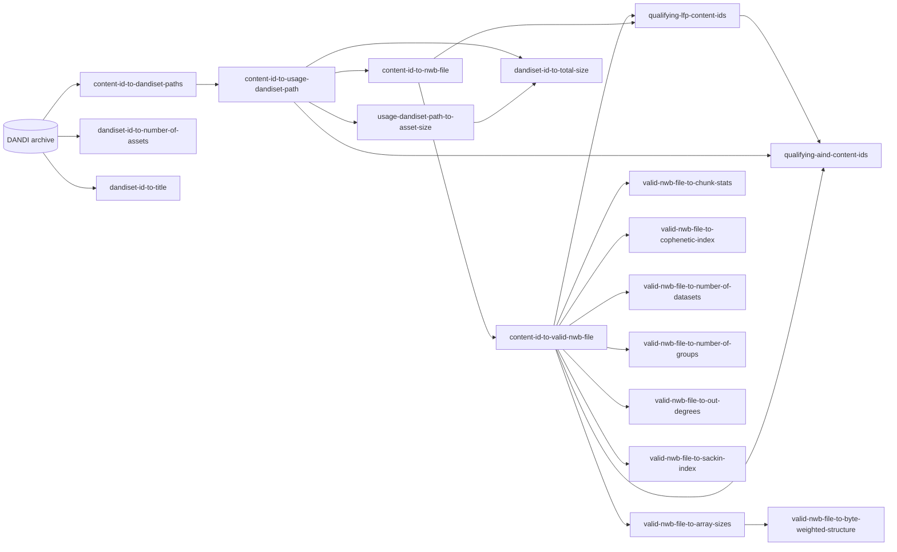

# 👋 Welcome to DANDI Cache!

This is a living collection of up-to-date pre-computed mappings commonly used by developers working with the DANDI Archive.

Check the `README` in each repository for usage instructions.

## Quick Links

### DANDI Archive

- :computer: [dandiarchive.org](https://dandiarchive.org/)
- :book: [The DANDI Handbook](https://www.dandiarchive.org/handbook)
- :tv: [The DANDI Youtube channel](https://www.youtube.com/channel/UCsLLBNhtcV-wL8cCZWveDCA)
- :raising_hand: [Support forum](https://github.com/dandi/helpdesk/discussions)
